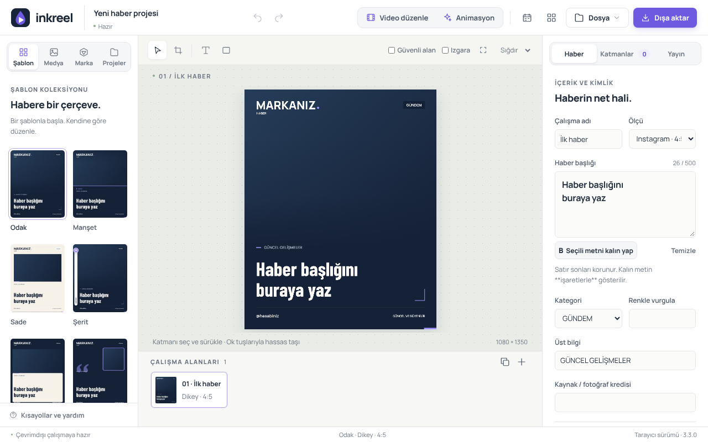

<div align="center">
  

  **Hikâyeni tasarla, düzenle ve paylaşmaya hazırla.**

  Haber görsellerinden kısa videolara, sosyal medya içeriklerini tek bir çalışma alanında hazırla.

  ### [⬇ Windows için indir · 3.3.1](https://gitlab.com/Turkish_Vito/inkreel/-/releases/v3.3.1/downloads/Inkreel-3.3.1-Setup.exe) &nbsp;&nbsp;&nbsp; [⬇ Android için indir · 3.3.0](https://gitlab.com/Turkish_Vito/inkreel/-/releases/v3.3.0/downloads/Inkreel-3.3.0-Android.apk)

  [Sürüm bilgileri](https://gitlab.com/Turkish_Vito/inkreel/-/releases/v3.3.1) · [Kurulum](#kurulum) · [Güncellemeler](#güncellemeler) · [Kaynak kodu](source/README.md)

  Windows 10 / 11 · 64 bit &nbsp; • &nbsp; Android 8+ &nbsp; • &nbsp; Manuel kurulum
</div>

---

## Fikrinden paylaşıma

Inkreel (eski adıyla Karevo); içerik üreticileri, haber sayfaları ve kendi markası için paylaşım hazırlayanlar için bir görsel ve video içerik düzenleyicisidir. Hazır şablonlarla başlayabilir, kendi görsellerini ve marka öğelerini kullanarak tasarımını kişiselleştirebilirsin.

| Tasarla | Video düzenle | Düzenini koru |
| --- | --- | --- |
| Hazır şablonlar, metin, şekil ve görsel katmanlarıyla içerik oluştur. | Tek klibi zaman çizelgesinde kes; kadraj, yazı ve ses ayarlarını düzenle. | Marka profillerini kullan, projelerini kaydedip çalışmana daha sonra devam et. |

- **İçeriğine uygun görünüm:** Kendi logonu, renklerini ve görsellerini kullan.
- **Paylaşıma hazır çıktılar:** Görselleri PNG veya JPG olarak dışa aktar; birden fazla çıktıyı toplu hazırla.
- **Kısa videolar ve animasyonlar:** Videonun başlangıç ve bitişini zaman çizelgesinden seç, oynatma konumunu kontrol et ve animasyonlu içerikler hazırla.
- **Kendi çalışma alanın:** Projelerini kaydedip daha sonra düzenlemeye devam et. Video işleme cihazında yapılır.



Video düzenleyici tek kliple çalışır. Kaynak video en fazla 5 dakika ve 120 MiB, çıktı ise 0,25–60 saniye olabilir. MP4 ve WebM desteği cihazın kodlayıcılarına göre değişebilir.

## Kurulum

**Windows**

1. [Inkreel Windows kurucusunu indir](https://gitlab.com/Turkish_Vito/inkreel/-/releases/v3.3.1/downloads/Inkreel-3.3.1-Setup.exe).
2. İndirilen `Inkreel-3.3.1-Setup.exe` dosyasını aç ve kurulum adımlarını izle.
3. Uygulamayı aç, bir şablon seç ve ilk tasarımını oluştur.

**Gereksinim:** Windows 10 veya Windows 11, 64 bit. Kurulumdan önce mevcut çalışmalarını proje dosyası olarak yedekle.

**Android**

[Inkreel Android APK’sını indir](https://gitlab.com/Turkish_Vito/inkreel/-/releases/v3.3.0/downloads/Inkreel-3.3.0-Android.apk), dosyayı aç ve kurulum adımlarını izle. Android 8 veya üzeri gerekir. Inkreel, telefonundaki Karevo uygulamasının yanına yeni, bağımsız bir uygulama olarak kurulur. Karevo’daki çalışmalarını proje dosyası olarak dışa aktarıp Inkreel’de açabilirsin; sonra Karevo’yu kaldırabilirsin.

**Projeler:** Yeni kayıtlar `.inkreel` uzantısını kullanır. Eski `.karevo`, `.bulten` ve `.netice` projeleri de açılabilir.

<details>
<summary>Windows uyarısı ve doğrulama bilgileri</summary>

Kurucu henüz Windows yayıncı sertifikasıyla imzalanmadığı için Microsoft Defender SmartScreen bir uyarı gösterebilir. Kurucu içeriği ve dosya bütünlüğü kontrol edilmiştir; bu sürümün kurulumu gerçek bir Windows cihazında henüz doğrulanmadı.

</details>

## Güncellemeler

**3.2.4 ve sonrası otomatik güncellenir.** Karevo 3.2.4 kullanıyorsan Inkreel güncellemesi kendiliğinden gelir; ayarlarını değiştirmen gerekmez. Yeni kurulumda uygulamanın **Güncellemeler → Güncelleme ayarları** bölümüne şunu yaz ve kaydet:

```text
Turkish_Vito/inkreel
```

Otomatik denetim açıksa uygulama yeni sürümleri GitLab'dan kontrol eder; indirme ve kurulumu sen başlatırsın. Güncelleme bilgileri Ed25519 imzasıyla doğrulanır (anahtar kimliği `ed25519:17a876fe9ae838d3d31b2cf36a8f66cd`); indirilen kurucunun boyutu ve dosya özeti kontrol edilir. Bu doğrulama, Windows yayıncı sertifikasının yerini almaz.

**Karevo 3.2.3 veya daha eski bir sürüm kullanıyorsan Inkreel'i bir kez elle kur.** Güncellemeleri imzalayan anahtar değişti; eski sürümler yeni güncellemeleri tanımaz. Yukarıdaki bağlantıyla Inkreel'i kurman yeterli; aynı klasöre kurulur, projelerin ve ayarların korunur.

Android sürümü bu sayfadaki APK ile elle güncellenir.

## Sürümler ve arşiv

[Inkreel 3.3.1 sürümünü görüntüle](https://gitlab.com/Turkish_Vito/inkreel/-/releases/v3.3.1) · [Tüm sürümler](https://gitlab.com/Turkish_Vito/inkreel/-/releases)

Windows ve Android kaynakları, testler ve derleme talimatları artık [Kaynak kodu](source/README.md) bölümündedir. Windows ve Android kurucuları GitLab Releases bölümündedir; indirme bağlantıları ve dosya özetleri doğrulanmıştır. İmzalı otomatik güncelleme kanalı GitLab'da çalışıyor.

<details>
<summary>Önceki sürümler ve mevcut projelerle uyumluluk</summary>

Inkreel daha önce Karevo, ondan önce de Bülten Studio adıyla sunuluyordu. Eski adlarla yayımlanan sürümler arşiv olarak korunur. Güncel sürüm için bu sayfanın üstündeki bağlantıyı kullan.

Windows’ta Inkreel, Karevo’nun kurulu olduğu klasöre kurulur; Karevo programı ve kısayolları Inkreel ile değiştirilir, verilerin yerinde kalır. Android sürümü ayrı kurulur, eski uygulamanın verilerini otomatik taşımaz. 3.0 ve önceki sürümlerde güncel kurucuyu bir kez elle kurmak gerekir.

Proje daha önce GitHub'da yayımlanıyordu; o adres artık kullanılmıyor ve yeni adrese yönlendirmiyor. Güncel indirmeler ve güncellemeler yalnızca GitLab'dadır.

</details>

## Kaynak kodu ve depolar

Asıl depo [GitLab](https://gitlab.com/Turkish_Vito/inkreel)'dadır; sürümler ve otomatik güncellemeler oradan yayımlanır. [GitHub](https://github.com/Yusufozkal/inkreel) aynı geçmişin yansısıdır ve GitLab'a her gönderimde kendiliğinden güncellenir. Karevo ve Bülten Studio dönemlerinin bütün geçmişi ve sürüm etiketleri her iki depoda da durur.
